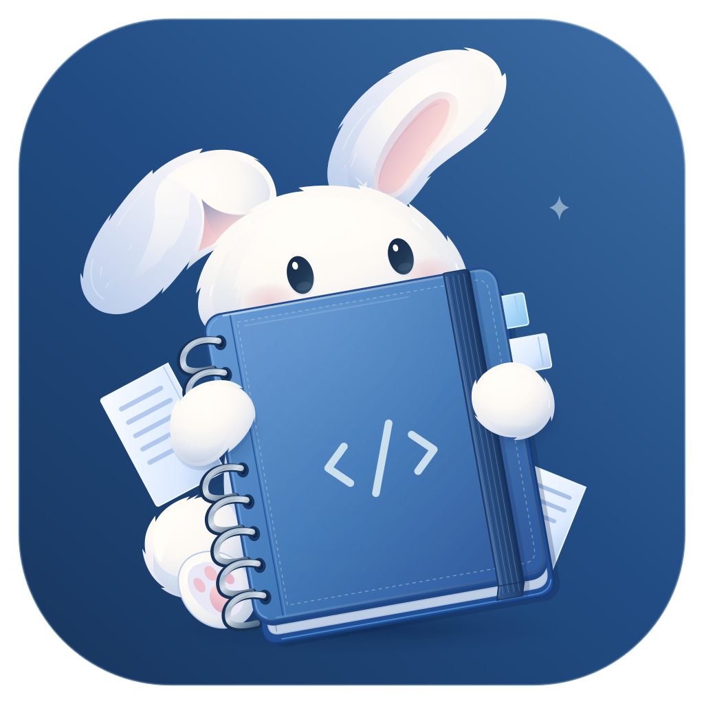

# Fragile Notepad

A desktop text editor for notes and source files. Written in Rust with
[Iced](https://iced.rs), for Windows and Linux, with experimental macOS support.

[Releases](https://github.com/fragile-notepad/fragile-notepad/releases)
&nbsp;·&nbsp; [Packaging](PACKAGING.md)

> Generative AI was used throughout development.

## Features

- Multiple windows with pinned, reorderable, and detachable tabs.
- Multiple carets, rectangular selections, word wrap, and undo/redo.
- Syntax highlighting, code folding, and function navigation.
- Find and replace with regular expressions across tabs and windows.
- Unicode, CJK text, legacy encodings, and configurable line endings.
- Session recovery for unsaved text, customizable shortcuts, and themes.

## Build from source

Requires Git, stable [Rust](https://rustup.rs), Python 3.10+, and native build tools;
Linux packages are listed in [CI](.github/workflows/ci.yml). Use `python3` on Unix.

```sh
git clone https://github.com/fragile-notepad/fragile-notepad.git
cd fragile-notepad
python -m pip install -r scripts/requirements-assets.txt -r scripts/requirements-font-profiles.txt
```

Generate assets for your platform:

| Platform | Command |
| --- | --- |
| Windows (PowerShell) | `.\scripts\generate_icon_assets.ps1` |
| Linux / macOS | `bash scripts/generate_icon_assets.sh` |

Then launch the editor:

```sh
cargo run --release --locked
```

The first build may download fonts. Regenerate assets after SVG changes.
Add `--no-default-features` for software-only rendering; see
[Vulkan setup](VULKAN_RENDERING.md#runtime-and-maintenance) for GPU requirements,
including macOS runtime setup.

## Checks

Run `.\scripts\ci.ps1` on Windows or `bash scripts/ci.sh` on Unix to generate assets,
check formatting, run tests, and check the software-only build.

## Documentation

- [Packaging and macOS app bundles](PACKAGING.md)
- [Optional file-manager integrations](components/README.md)
- [Rendering design and diagnostics](SEAMLESS_HYBRID_RENDERING.md)
- [Application architecture](src/app/README.md)

## License

Code uses [BSD-3-Clause](LICENSE); [vendored dependencies](vendor/README.md) retain
their upstream licenses. Original [colored icons](assets/icons/colored/LICENSE)
and [illustrations](assets/illustrations/LICENSE), including rasters and reproductions,
are **all rights reserved** and excluded from the code license.
Other bundled icons retain their MIT licenses; see [artwork notices](assets/icons/NOTICE.txt).
