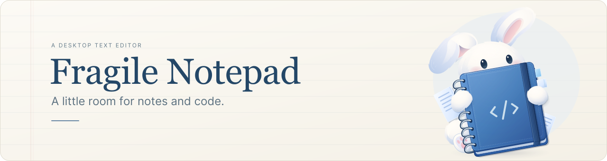
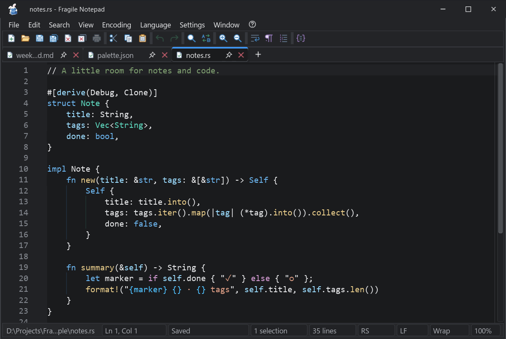
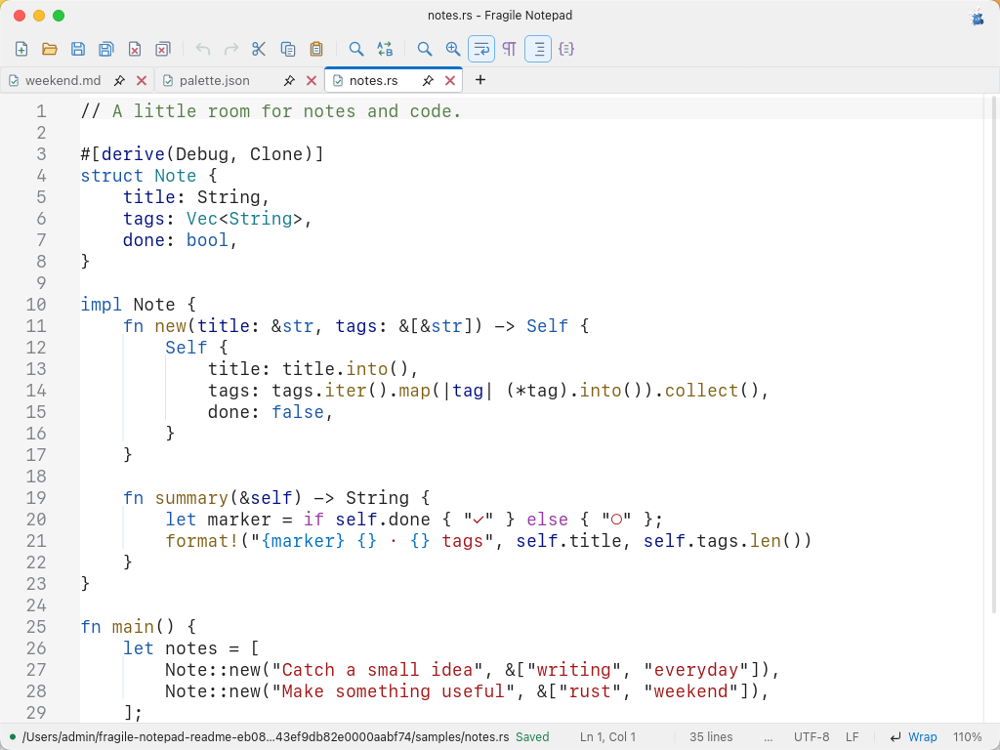

  <picture>
    <source media="(max-width: 600px)" srcset="assets/illustrations/readme/banner-compact.svg">
    
  </picture>

  <a href="https://github.com/fragile-notepad/fragile-notepad/releases"><strong>Download</strong></a>
  &nbsp; · &nbsp; <a href="docs/getting-started.md">Get started</a>
  &nbsp; · &nbsp; <a href="docs/README.md">Documentation</a>
  &nbsp; · &nbsp; <a href="CONTRIBUTING.md">Contribute</a>

# Fragile Notepad

Fragile Notepad is a desktop text editor for notes and source files, built with
Rust and [Iced](https://iced.rs). It supports Windows and Linux, with experimental
macOS support.

## Get started

Download an archive from [Releases](https://github.com/fragile-notepad/fragile-notepad/releases),
extract it, and follow the [getting started guide](docs/getting-started.md).

## Screenshots

**Windows** · Dark appearance

**macOS** · Light appearance

## Features

- Multiple windows with pinned, reorderable, and detachable tabs.
- Multiple carets, rectangular selections, word wrap, and undo/redo.
- Syntax highlighting, code folding, and function navigation.
- Find and replace with regular expressions across tabs and windows.
- Unicode, CJK text, legacy encodings, and configurable line endings.
- Session recovery for unsaved text, customizable shortcuts, and themes.

## Documentation

| Goal | Guide |
| --- | --- |
| Build the editor | [Build from source](docs/development/building.md) |
| Validate a change | [Test and validate](docs/development/testing.md) |
| Create a release archive | [Packaging](docs/development/packaging.md) |
| Understand the implementation | [Application architecture](docs/architecture/application.md) |

## License

Code uses [BSD-3-Clause](LICENSE); [vendored dependencies](vendor/README.md) retain
their upstream licenses. Original [colored icons](assets/icons/colored/LICENSE)
and [illustrations](assets/illustrations/LICENSE), including rasters and reproductions,
are **all rights reserved** and excluded from the code license.
Other bundled icons retain their MIT licenses; see [artwork notices](assets/icons/NOTICE.txt).
The [file-type icon collection](assets/icons/file-types/LICENSE) has separate
artwork and third-party terms.

Generative AI was used throughout development.
